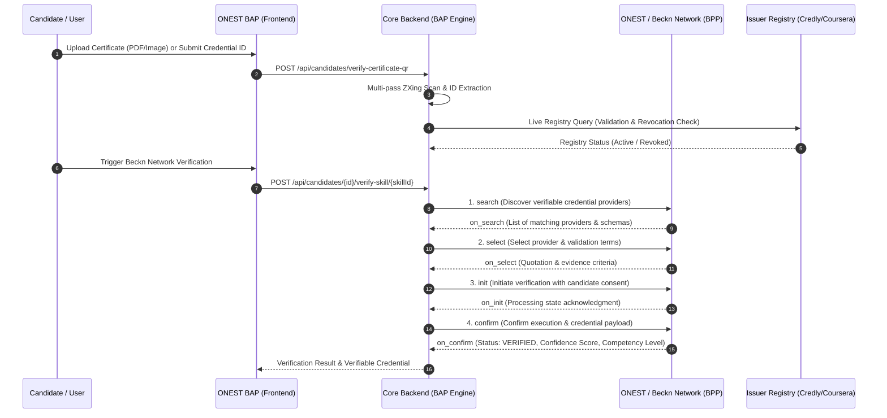
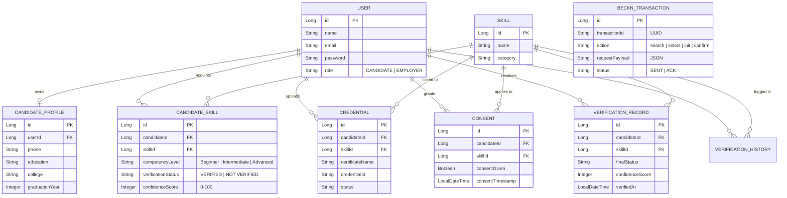

# Beckn-Based Skill Verification Network with ONEST Framework

An open, decentralized skill verification and credential validation platform built on the **Beckn Protocol** and the **ONEST (Open Network for Education and Skilling Transactions) Framework**.

---

## 🌟 Overview & Problem Statement

In traditional hiring ecosystems:
- **Walled Gardens:** Certifications and skill claims are trapped in siloed platforms (LinkedIn, Naukri, Coursera, university portals).
- **Rampant Credential Fraud:** Candidates submit forged certificates, Photoshop-altered documents, or dummy QR codes that lead to deceptive destinations.
- **Verification Bottlenecks:** Employers and BAPs (Beckn Application Platforms) have no unified, interoperable mechanism to independently verify credentials without maintaining point-to-point integrations with hundreds of issuers.

The **Beckn-Based Skill Verification Network with ONEST Framework** solves this by establishing:
1. **Decentralized Interoperability:** Implements the open Beckn Protocol (`search`, `select`, `init`, `confirm`) and ONEST taxonomy to discover, request, and verify skills across decentralized nodes.
2. **Optical Certificate Authenticity & QR Scanner:** Extracts and validates embedded or printed QR codes and Certificate IDs directly from high-resolution PDF pages (200/300 DPI) and images via ZXing multi-pass binarizers.
3. **Counterfeit & Fraud Detection:** Detects deceptive payloads (e.g. dummy QR codes redirecting to google.com/youtube.com) and verifies credential authenticity in real-time against authoritative issuer registries (Credly, Coursera, Udemy, HackerRank, Oracle, etc.).
4. **Candidate & Employer Dashboards:** Allows candidates to manage their unified profile and sync verified credentials, while employers discover verified talent through aggregated Confidence Scores (0–100%) and Competency Levels.

---

## 🏛️ System Architecture

```mermaid
graph TD
    subgraph Frontend Application ["Frontend Application (React + Vite + Tailwind CSS)"]
        UI[Candidate & Employer UI]
        ResumeVerifier[Resume & Certificate Verifier]
        VerificationFlow[Beckn Verification Pipeline]
        UI --> ResumeVerifier
        UI --> VerificationFlow
    end

    subgraph ONEST_Beckn_Layer ["ONEST Framework & Beckn BAP/BPP Layer"]
        BAP_Controller[Beckn BAP Controller]
        BecknService[Beckn Protocol Service]
        TxnTracker[Beckn Transaction Tracker]
        BAP_Controller <--> BecknService
        BecknService --> TxnTracker
    end

    subgraph SpringBoot_Backend ["Spring Boot Core Engine"]
        CandidateController[Candidate REST Controller]
        EmployerController[Employer REST Controller]
        ResumeParsingService[Resume PDF & Link Extraction Service]
        QrService[Optical QR & Certificate Authenticity Service]
        CredlyService[Live Registry Verification Service]
        Database[(MySQL Database)]

        CandidateController --> ResumeParsingService
        CandidateController --> QrService
        CandidateController --> CredlyService
        CandidateController --> BecknService
        ResumeParsingService --> Database
        QrService --> Database
        BecknService --> Database
    end

    subgraph External_Networks ["External Registries & ONEST Network"]
        ONEST_Gateway[ONEST Gateway / Open Network]
        Credly[Credly Digital Badges]
        Coursera[Coursera Verification]
        Udemy[Udemy / HackerRank]
        Oracle[Oracle / Cisco Registries]
        
        BecknService <--> ONEST_Gateway
        QrService --> Credly
        QrService --> Coursera
        QrService --> Udemy
        QrService --> Oracle
    end

    Frontend Application -->|REST / Multipart Form| SpringBoot_Backend
```

---

## 🔄 ONEST & Beckn Protocol Verification Lifecycle

The platform follows the standard 4-step Beckn Protocol schema:



---

## 🗄️ Database Schema (ERD)



---

## 🚀 Key Features

### 1. Optical Certificate Authenticity & QR Scanner
- **Multi-Format Input:** Accepts entire certificates as PDF files or images (JPEG, PNG, WebP) as well as standalone QR codes.
- **High-Definition PDF Rendering:** Uses Apache PDFBox to render document pages at 200 DPI and 300 DPI, extracting embedded image streams (`PDImageXObject`).
- **Multi-Pass ZXing Binarization:** Leverages `HybridBinarizer` and `GlobalHistogramBinarizer` across global view, central regions, and sub-quadrants (top-left, top-right, bottom-left, bottom-right).
- **Printed Certificate ID Extraction:** Automatically identifies alphanumeric serial numbers (e.g. Oracle eCertificate IDs, Cisco Cert IDs) from document text when optical QR codes are compressed.
- **Counterfeit Detection:** Detects dummy QR codes that route to generic websites (e.g. `google.com`, `youtube.com`) rather than accredited credential authorities.
- **Live Registry Validation:** Validates digital badges in real-time against Credly, Coursera, Udemy, HackerRank, Oracle, etc.
- **Instant Profile Sync:** Automatically matches verified skills to the candidate's account and updates verification status.

### 2. Resume & Credential Link Scanner
- Parses resumes (PDF/DOCX) using Apache PDFBox to extract contact details, educational background, and credential hyperlinks.
- Distinguishes between verifiable issuer URLs (e.g. Credly, Coursera) and generic links.

### 3. ONEST & Beckn Protocol Transaction Engine
- **Full Beckn v1.1.0 Protocol Engine:** Implements the official Beckn specifications (`context`, `intent`, `catalog`, `order`, `ack`) under domain taxonomy `onest:work-opportunities`.
- **Ed25519 Cryptographic Signatures:** RFC-compliant HTTP Authorization signatures with `created`, `expires`, and `Digest: SHA-256=<base64>` header hashing.
- **Real HTTP Network Transport:** `RealBecknClient` dispatches real HTTP POST requests with asymmetric signatures and handles asynchronous BAP/BPP callbacks (`/on_search`, `/on_init`, `/on_confirm`).
- **Embedded ONEST BPP Provider Node:** Includes an embedded Provider node (`/api/bpp/search`, `/init`, `/confirm`) enabling realistic multi-node network simulation on localhost or external gateways via ngrok.
- **Audit Trails:** Persists every network transaction in `beckn_transaction` for tamper-evident transparency.

### 4. Employer Talent Discovery Portal
- Search candidates by skill with real-time filtering.
- Displays transparent Trust & Confidence Scores (0–100%) and assessed Competency Levels (Beginner, Intermediate, Advanced).

---

## 🛠️ Technology Stack

- **Backend:** Java 17/21, Spring Boot 3, Spring Data JPA, Hibernate, BouncyCastle (Ed25519 Cryptography), Apache PDFBox, ZXing (Zebra Crossing) 3.5.3, Jackson Databind, MySQL 8.0.
- **Frontend:** React 18, Vite, Tailwind CSS, Lucide Icons, Axios, Canvas Confetti.
- **Protocols & Standards:** Beckn Protocol Core Specification v1.1.0, ONEST Framework Taxonomy (`onest:work-opportunities`), RFC 8032 (Ed25519 Signatures), RFC 7230 (HTTP Signatures).

---

## 💻 Setup & Installation

### Prerequisites
- Java JDK 17 or 21
- Apache Maven 3.8+
- Node.js 18+ & npm
- MySQL 8.0+

### 1. Database Setup
```sql
CREATE DATABASE skill_verification;
```
Ensure database credentials match `backend/src/main/resources/application.properties`:
```properties
spring.datasource.url=jdbc:mysql://localhost:3306/skill_verification?createDatabaseIfNotExist=true&useSSL=false&allowPublicKeyRetrieval=true
spring.datasource.username=root
spring.datasource.password=
```

### 2. Run Backend
```bash
cd backend
mvn spring-boot:run
```
Backend starts on `http://localhost:8080`.

### 3. Run Frontend
```bash
cd frontend
npm install
npm run dev
```
Frontend runs on `http://localhost:5173`.

---

## 👥 Demo Credentials

- **Candidate Portal:** Sign up with your details to create a candidate profile or use existing credentials.
- **Employer Portal:**
  - **Email:** `employer@test.com`
  - **Password:** `password`
